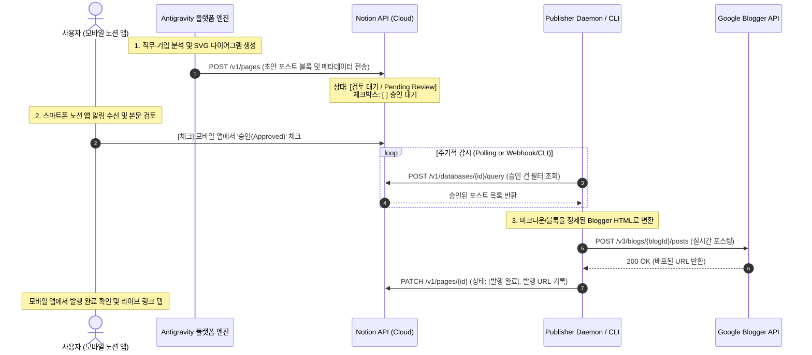

# [기술 설계 및 계획서] 노션 모바일 승인 기반 Blogger 퍼블리싱 파이프라인 및 한·체코 전수 기업 API 확장 플랜

**문서 식별자**: `PLAN-NOTION-MOBILE-APPROVAL-AND-COUNTRY-API-20261015`  
**상태**: `PLANNING_ONLY (사용자 승인 대기 / 실행 보류 상태)`  

---

## 1. 개요 (Goal Description)

본 계획서는 다음 3대 핵심 과제의 기술적 실행 방안을 확립합니다:
1. **노션 모바일 승인 기반 Blogger 헤드리스 자동 퍼블리셔(Human-in-the-Loop CMS) 파이프라인 설계**:
   * 에이전트가 생성한 기업/직무 분석 보고서 및 SVG 다이어그램을 노션 데이터베이스(발행 대기열)로 전송.
   * 사용자가 스마트폰 노션 모바일 앱에서 초안을 검토하고 `승인(Approved)` 체크박스 또는 상태를 변경하면, 헤드리스 퍼블리셔가 즉시 감지하여 Google Blogger로 원클릭 발행하는 닫힌 루프(Closed-Loop) 구축.
2. **노션 API 키(`NOTION_API_KEY`) 및 `intellectronica/agent-skills@notion-api` 연동 무결성 사전 검증**.
3. **#2 기업 식별/스크리닝 및 #3 재무·가치평가 착수 전, 한국과 체코의 전체 기업 채용 및 재무 정보 접근 실태 감사 및 동적화(Dynamic Resolution) 계획 수립**.

---

## 2. 사용자 검토 필요 사항 (User Review Required)

> [!IMPORTANT]
> **노션 봇 연결(Connect) 필수 권한**:
> 에이전트가 실측한 결과, `.env`의 `NOTION_API_KEY`는 **"안티그래비티 자동화 키"**라는 봇(Bot) 계정으로 정상 인증되었으며 현재 `에이전트 개발 로그 (ID: 2c047b33-3f24-80a3-93d3-d5c505afea8a)` 페이지에 접근 권한이 있습니다.
> 모바일 승인 워크플로우를 원활히 구동하기 위해서는, 발행 대기열로 사용할 신규 데이터베이스나 해당 페이지 우측 상단 `···` ➔ `연결(Connect to)` 메뉴에서 **"안티그래비티 자동화 키"**가 연결되어 있어야 합니다.

> [!WARNING]
> **OpenDART 고정 픽스처(Fixture) vs 동적 전체 기업(Dynamic) 차이**:
> 현재 리포지토리의 OpenDART는 삼성전자(00126380) 단일 고정 픽스처 테스트만 구비되어 있습니다. 대한민국 10만+ 개 상장/외감 법인 전수를 임의로 검색·조회하려면 `api/corpCode.xml`(전체 고유번호 마스터)을 DuckDB에 로컬 색인하는 단계가 선행되어야 합니다.

---

## 3. 노션 모바일 승인 ➔ Blogger 헤드리스 퍼블리셔 아키텍처



### 노션 발행 대기열 데이터베이스 스키마 정의
* **`포스트 제목`** (Title)
* **`타겟 카테고리`** (Select: `직무 트랙 분석`, `기업 재무 스크리닝`, `거시 시나리오`)
* **`발행 상태`** (Status / Select): `초안 생성` ➔ `검토 대기` ➔ `발행 승인` ➔ `발행 완료`
* **`모바일 승인`** (Checkbox): 모바일 화면에서 원터치 토글
* **`발행 일시`** (Date)
* **`공개 링크`** (URL): Blogger 배포 완료 시 자동 기입
* **`본문 블록`** (Page Content): 요약 마크다운, 핵심 지표 콜아웃, SVG 이미지 링크

---

## 4. 한국 및 체코 전수 기업 채용·재무 데이터 현황 감사 (Physical Grounding)

| 국가 | 구분 | 현재 구현 상태 (As-Is) | 사용 가능한 API 및 물리 증거 | 전체 기업 조회를 위한 격차 및 해결 방안 (To-Be) |
|---|---|---|---|---|
| **대한민국 (KR)** | **기업 채용** | • `mpm_public_employment` (나라일터) 완비<br>• 민간 상용(원티드/사람인) 부재 | • `MPM_PUBLIC_EMPLOYMENT_API_KEY`<br>• `.env`에 **워크넷 8종 API 키** 구비 완료 (`docs/워크넷 신청서.hwp`) | • 워크넷 OpenAPI 구인정보 커넥터(`getJobSearch.do`)를 정규 파이프라인으로 승격하여 **전국 민간·중소기업 5만+ 건 공고 실시간 검색** 활성화 |
| **대한민국 (KR)** | **기업 재무** | • 삼성전자 고정 픽스처(Fixture) 상태<br>• `financial_metrics` 유동성 지표 완비 | • `OPENDART_API_KEY`<br>• `ECOS_API_KEY` (한국은행) | • OpenDART `api/corpCode.xml`을 다운로드하여 **전체 10만+ 개 기업 고유번호 색인 테이블(DuckDB)** 구축<br>• 임의 기업명 ➔ corp_code 동적 조회 ➔ 재무제표 실시간 fetch 완성 |
| **체코 (CZ)** | **기업 채용** | • `mpsv_cz` 정규화 엔진 완비 (`normalize_mpsv_jobs`)<br>• CZ-ISCO 피벗 로직 완비 | • `https://data.mpsv.cz/od/soubory/volna-mista/` (무키 무료 오픈데이터) | • 체코 MPSV 일별 전수 덤프(압축 JSON/XML, 10만+ 건) 다운로더를 CLI 커넥터로 직결하여 **체코 전역 기업 채용 전수 집계** |
| **체코 (CZ)** | **기업 재무** | • ARES 커넥터 완비 (`https://ares.gov.cz/.../{ico}`)<br>• CNB 환율/금리 완비 | • ARES 경제주체 레지스트리 (무키 공개 REST API) | • IČO로 **체코 300만+ 사업자 상호, 주소, NACE 산업분류 실시간 검색** 가능<br>• 세부 손익계산서는 체코 상업등기소(Justice.cz) 재무제표 공시 연계 필요 |

---

## 5. 상세 추진 계획 및 단계별 제안 (Phase Roadmap)

### Phase 1: 노션 모바일 승인 큐 구축 및 양방향 커넥터 구현
* **[NEW] `src/company_intel/notion_queue.py`**:
  * 노션 REST API(`https://api.notion.com/v1`)를 직접 활용하여 발행 대기열 생성, 승인 상태 감시(Polling), 발행 완료 업데이트 수행.
* **[NEW] `src/company_intel/publisher/blogger_publisher.py`**:
  * Blogger API v3 클라이언트 탑재 및 마크다운 ➔ Blogger 호환 HTML 포맷터 구현.
* **[NEW] CLI 명령 추가**:
  * `company-intel 블로그-발행-대기열` / `post-queue`
  * `company-intel 승인-발행-동기화` / `sync-approved`

### Phase 2: 한국 전체 기업 OpenDART 고유번호 색인 및 워크넷 채용 어댑터 연동
* **[NEW] `src/company_intel/connectors/opendart_master.py`**:
  * `api/corpCode.xml` 다운로드 및 DuckDB `kr_company_master` 테이블 구축 (회사명 ➔ corp_code 동적 매핑).
* **[NEW] `src/company_intel/connectors/worknet.py`**:
  * `.env`의 `WORKNET_*` 키를 활용한 실시간 채용공고 동적 조회기 탑재.

### Phase 3: 체코 MPSV 전수 다운로더 연계
* **[MODIFY] `src/company_intel/connectors/keyless.py`**:
  * 체코 노동사회부 오픈데이터 덤프 자동 스트리밍 수집기 직결.

---

## 6. 검증 계획 (Verification Plan)

### Automated Tests
1. **노션 API 큐 송수신 테스트**:
   ```bash
   .venv/bin/pytest tests/test_notion_queue.py -v
   ```
2. **OpenDART 동적 고유번호 검색 테스트**:
   ```bash
   .venv/bin/pytest tests/test_opendart_master.py -v
   ```
3. **전체 회귀 테스트**:
   ```bash
   .venv/bin/pytest
   ```

### Manual Verification
* 노션 모바일 앱에서 에이전트가 등록한 테스트 초안 페이지의 '모바일 승인' 체크박스를 탭한 후, CLI에서 `sync-approved` 실행 시 정상 감지되는지 검증.
